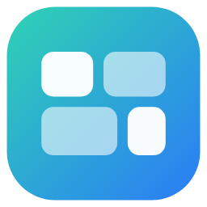

<p align="center"></p>

# Control Hub

Control Hub keeps Mads's projects in one place, starting with the **Control Panel** widget for the CORSAIR XENEON EDGE.

- **Control Hub Service** runs quietly in the tray and powers the widget (Spotify, Discord, sound, flight sim and more). It replaces the old *Control Panel Helper*.
- **Control Hub** is the app window: projects, connections, backups and help. It only runs while it's open; the panel never needs it.

## Install

1. Download this repository (**Code → Download ZIP**) and unzip it.
2. Double-click **Install Control Hub.bat**.

The installer:

1. builds both programs with the C# compiler that comes with Windows; if that fails, nothing is changed,
2. installs them in `%LOCALAPPDATA%\Programs\Control Hub`, with no admin needed,
3. adds **Control Hub** to the Start menu and starts the service,
4. packs the widget and opens it in iCUE, where you click to update it.

The first time it runs, the service closes the old Control Panel Helper, takes over its "start with Windows" setting and copies its settings folder (`%APPDATA%\ControlPanelHelper` → `%APPDATA%\ControlHub`). That covers logins, backups, pictures and flight tracks. The old folder is left as a spare copy.

## What's where

| Folder | What |
|---|---|
| `service/` | Control Hub Service (C# 5, .NET Framework 4) |
| `hub/` | The Control Hub app window (WinForms) |
| `widget/` | The Control Panel iCUE widget (HTML/JS) |
| `shared/` | The logo |
| `docs/` | The Control Panel guide (every tile and feature) |
| `version.json` | Version numbers and what's new. The Update button reads this. |
| `update.json` | Where updates come from (owner, repo, branch) |
| `projects/` | Projects installed together with Control Hub |
| `projects.json` | Extra projects shown in Control Hub → Projects |
| `Restore previous version.bat` | Puts the last version back |

## Adding a project to Control Hub

Add an entry to `projects.json` in the install folder:

```json
{
	"projects": [
		{
			"name": "FlightLine Live",
			"description": "Flight dashboard for the phone over WiFi",
			"folder": "%USERPROFILE%\\Projects\\FlightLine Live",
			"start": "%USERPROFILE%\\Projects\\FlightLine Live\\start.bat",
			"process": "node",
			"url": "http://localhost:3000"
		}
	]
}
```

Every field except `name` is optional. `process` is the program name (without `.exe`) used to show Running / Not running.

## Updates

After the first install, you never unzip again. In **Control Hub → Projects → Updates**:

1. Control Hub checks `version.json` here on GitHub. It checks by itself when you open it, and every hour while it's open.
2. If there's a newer version, it shows **What's new** and an **Update** button.
3. **Update** downloads the newest version and starts *its* `Install Control Hub.bat` with `/update`. Because the new installer always does the installing, an update can change anything: new parts, new projects, the widget, and the updater itself.
4. The installer builds to the side first. If that fails, nothing changes. Otherwise it keeps the installed version in `previous\` and swaps in the new one.
5. **Go back to the previous version** (or `Restore previous version.bat` in the program folder) puts the last version back. It only restores the programs; settings and layout are never touched.

To publish a new version, change the code, raise `version` in `version.json`, add a few `notes`, and push to `main`. `update.json` in the program folder says where updates come from (owner, repo, branch).

Projects can be installed through the same updates: see `projects/README.md`.

### The panel updates through Control Hub too

The widget in iCUE is only a small **starter** (`widget/index.html`, `widget/manifest.json`, `widget/scripts/boot.js`). When it starts, it asks Control Hub Service which version of the panel it has (`/widget-version`). If that's the same or newer than the copy built into the widget, it loads the panel's layout, styles and scripts from Control Hub (`/widget/...`). If Control Hub isn't running, is older, or a file fails to load, it uses its built-in copy.

- **A normal panel update:** change the scripts or styles and raise `version` in `widget/files.js`. Don't touch the three starter files. The installer then copies the panel code to Control Hub, and iCUE isn't involved.
- **A starter change** (iCUE settings in `index.html`, permissions in `manifest.json`, or `boot.js`): the installer notices that those files changed and opens the widget in iCUE once, so you can accept it. Raise `manifest.json`'s version as well.
- **New script or style files:** add them to the lists in `widget/files.js`.

## Coming next

- A new look for the Control Hub window.
